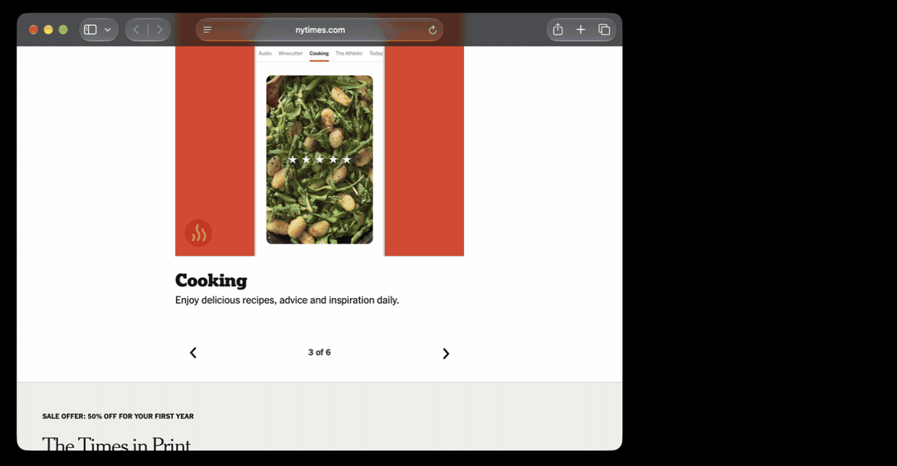
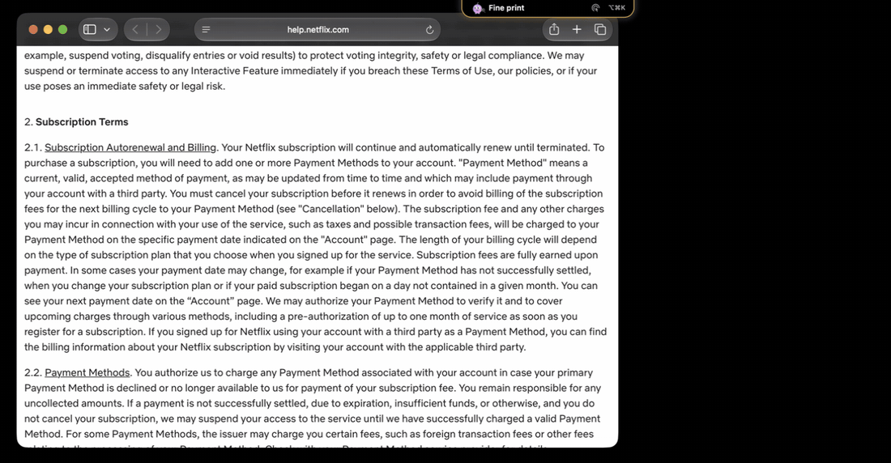
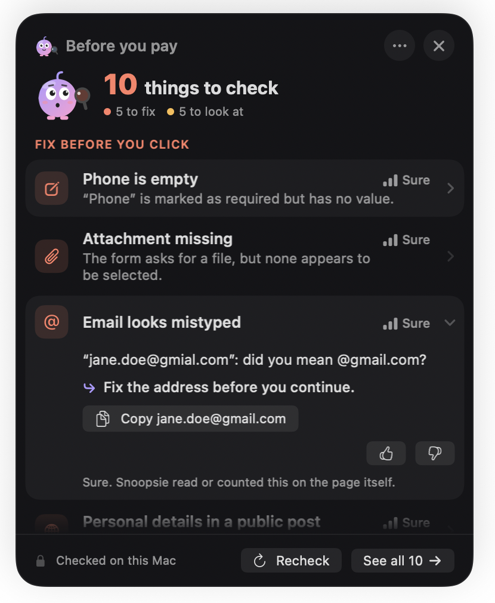
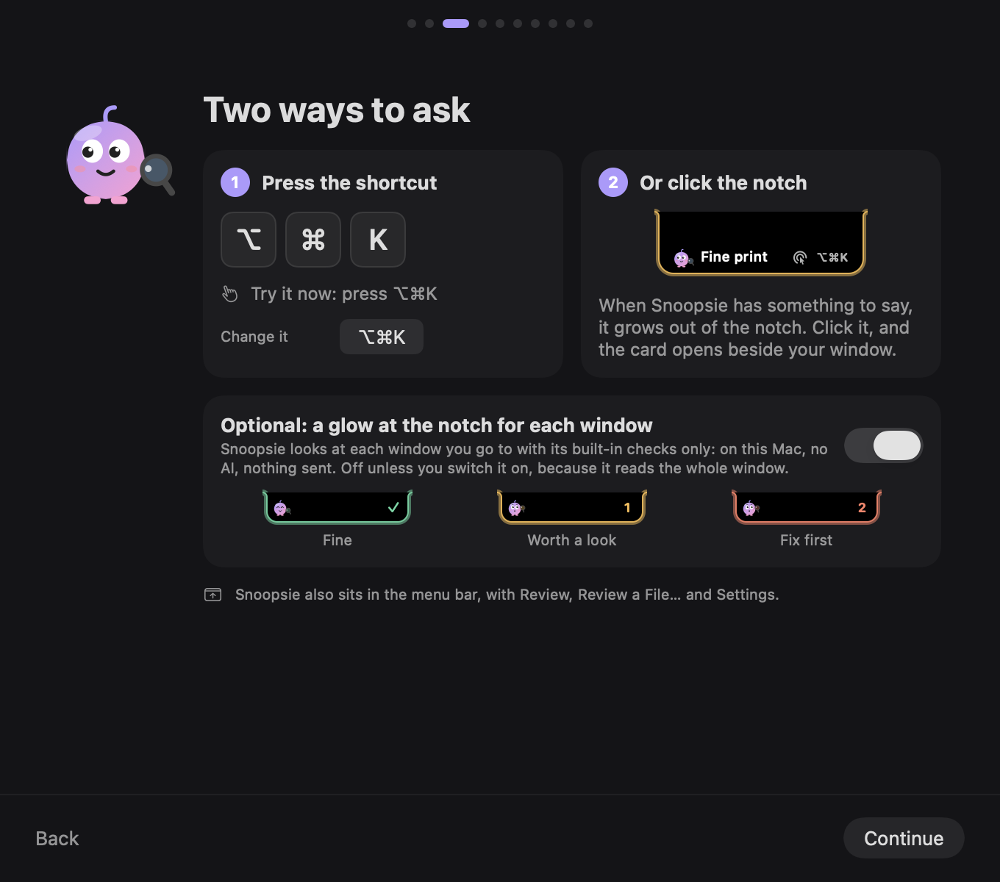
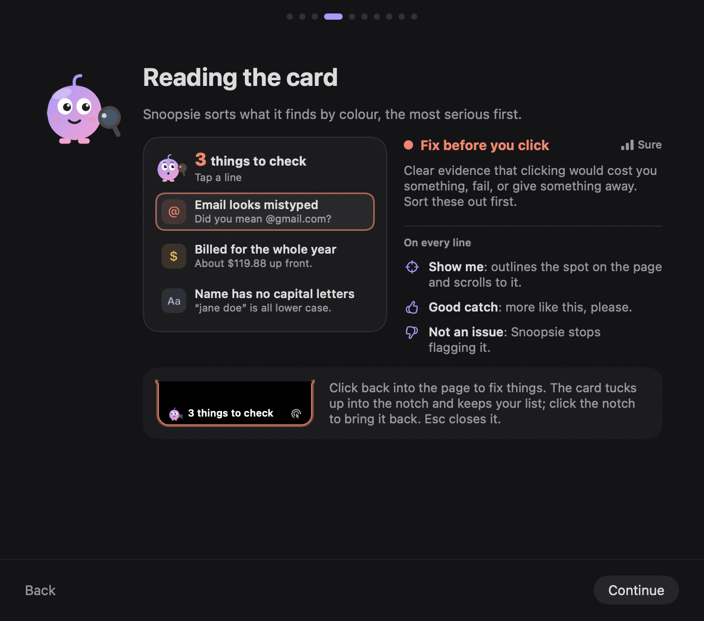

<p align="center">
  
</p>

<h1 align="center">Snoopsie</h1>

<p align="center">
  A Mac app that reads the page before you hit Pay, Send or Submit<br>
  and tells you what you're about to get wrong.
</p>

<p align="center">
  <a href="https://github.com/njason2811/Snoopsie/releases/latest"><b>Download Snoopsie 1.0 for Mac</b></a><br>
  <sub>macOS 26 or later · Apple Silicon · free</sub>
</p>

<p align="center">
  
</p>

You know the half second after you press Send, when you remember the attachment? Snoopsie is for the half second before.

Press <kbd>⌥</kbd> <kbd>⌘</kbd> <kbd>K</kbd> and it reads the window in front of you (a checkout, an email, a job application, a wall of terms) and puts up a small card of things worth a second look. Each one quotes the exact words it is about. It never clicks, types or submits anything, and it won't stop you clicking either. It tells you, and then it's your call.

That clip is a real recording, on the real page. The offer says $1 a week. The small print at the bottom says it becomes the standard price unless you cancel before a date a year away. Snoopsie found that line, and **Show me** scrolled to it.

## It reads the terms so you don't have to

<p align="center">
  
</p>

Netflix's terms of use, as they were when this was recorded. Six things to check, each with the sentence it came from, and two lines at the top that say what you'd be agreeing to. On a page like this the notch says "Fine print" by itself, so you know there is something to read before you scroll past it.

## It lives at the notch

<p align="center">
  
</p>

When Snoopsie has something to say, the notch grows a little and says it, then goes back in. Click it, or press the shortcut. The card opens beside your window, never on top of what you're reading. No notch on your Mac? You get a small black pill at the top of the screen instead.

If you like, it can also keep an eye on each window you go to and glow at the notch: coral for something to fix, amber for something worth a look, a green tick when a page you're about to act on is fine. That is off until you switch it on, because it means reading every window. It uses the built-in checks only, on your Mac.

There is a menu-bar icon too, with *Review a File…* for a PDF, a Word or PowerPoint file, an image or plain text, and *Review a Selected Area…* for part of the screen.

## Fix it, and watch the list go down

<table>
  <tr>
    <td width="46%" valign="top"></td>
    <td valign="top">
      <p>Where the fix is safe to state, the finding has a button for it. It copies the corrected text and you paste it in. Snoopsie doesn't type for you.</p>
      <p>Click back into the page and the card tucks up into the notch with a count. As you put things right the count goes down, and the card keeps a list of what you fixed. <b>Recheck</b> does the same on the spot.</p>
      <p><b>Good catch</b> and <b>Not an issue</b> under each finding teach it what you care about.</p>
    </td>
  </tr>
</table>

## Two minutes to set up

<table>
  <tr>
    <td width="50%"></td>
    <td width="50%"></td>
  </tr>
</table>

The welcome tour shows you how to ask and how to read the card before it asks you for anything. Then it's two permissions (Accessibility to read the page, Screen Recording for one screenshot when you ask for a review) and one button to download the model. The built-in checks work straight away while that arrives.

## Where your screen goes

An app that reads your screen ought to say where that goes.

- The checks and the model run on your Mac. There's no account and no analytics.
- Card numbers, IDs, bank numbers, keys and passwords are swapped for placeholders before any check or model sees the text. What you type in a password box is never read.
- Screenshots stay in memory and are thrown away when the card closes.
- If you give it your details so it can catch a typo in your own email or school, they live in the Keychain on your Mac.
- One thing can leave, and only if you leave it switched on. Very long fine print can get a second read from Gemini, through a small server that exists so the app never holds an API key. Only the masked text is sent. Settings → AI switches it off, and after that the only thing Snoopsie uses the network for is downloading the model once.
- Pages are treated as untrusted. Text that tries to give instructions to an AI is reported as a finding. It isn't followed.

## Install

1. Download `Snoopsie-1.0.dmg` from [Releases](https://github.com/njason2811/Snoopsie/releases/latest).
2. Open it and drag Snoopsie into Applications.
3. Open Snoopsie. The first time, macOS will say it can't check the app. Go to System Settings → Privacy & Security, scroll down, and click **Open Anyway**. You only do that once.

**This build isn't signed.** It has no Apple Developer ID signature and hasn't been notarised by Apple, which is why macOS stops it the first time and why step 3 is needed. Download it only from this page.

You need macOS 26 or later on Apple Silicon and about 4 GB free for the model (2.6 GB to download).

## What it won't do

- Click, type, submit or block anything.
- Tell you a page is safe. A clean result reads "No oopsies spotted", and all that means is nothing obvious turned up.
- Review a page because you happened to switch to it. A review happens when you ask.
- Read collapsed "show more" sections, or Google Docs unless screen-reader support is switched on.
- Anything useful on pages that aren't in English. The checks are written for English.

## What it catches

The plain lines were on a page. The coloured ones are what Snoopsie said about them: red for *fix before you click*, amber for *worth a look*.

```diff
  jane.doe@gmial.com
- Email looks mistyped. “jane.doe@gmial.com”: did you mean @gmail.com?

  Expiry 04/24
- Card has expired. The expiry date “04/24” is in the past.

  $9.99/month          (•) Billed yearly
! Shown per month, billed for the year. The first charge is likely about $119.88.

  Billed as $4 every four weeks for your first year, then $30 thereafter.
! Price rises to $30. It's $4 for the first year, then $30.

  [x] Add device protection for $4.99/month
! An extra is ticked. “Add device protection for $4.99/month” is already selected.

  “…the Q3 report is attached”   attached: Q2_report.pdf
! Attachment may be the wrong one.

  scan_report_2026.pdf.exe
- A program disguised as a document. It ends in .exe, so it's a program, not a PDF.

  “To verify you are human, open Terminal and paste…”
- This page wants you to run a command.

  “PayPal: Log in”   at paypa1-secure.example.net
- This may not be PayPal's real page. The address isn't paypal.com.
```

There are 91 built-in checks like these. Each one is tested both ways: it has to fire on the mistake and stay quiet on the ordinary page that looks like one. An article about scams doesn't set off the scam checks, and a shop with a single "only 3 left" isn't accused of rushing you.

After the checks, a small language model running on your Mac reads every line for what rules can't see: two answers that contradict each other, the same fact given two ways, an odd commitment buried in the terms.

## Under the hood

<details>
<summary><b>How it works</b></summary>

```
⌥⌘K / the notch ─▶ target window (recorded before any UI appears)
                ─▶ capture: Accessibility tree (+ full page text) + 1 screenshot + Vision OCR
                   + the open document (every page) + earlier steps on the same site
                ─▶ corpus: one numbered list of lines, with cards, SSNs, IBANs and secrets masked first
                ─▶ 91 built-in checks (≈0.5 s, shown immediately)
                ─▶ Gemma reads every line in parts; findings stream in
                ─▶ every quote verified against the corpus ─▶ dedupe (rules beat AI) ─▶ rank ─▶ card
```

**Reading.** Snoopsie walks the macOS Accessibility tree of the front window and takes the page's full text, so it sees what's far below the fold too. If you're in a dialog (a Gmail compose window, a checkout pop-up), only the dialog is reviewed. Document apps get the whole file. Nothing keys off a site's address. The checks look at what a page contains, which is why they work on sites nobody tried them on.

**Rules, then a model.** The built-in checks are plain Swift, deterministic, and done in about half a second, so the card has something to show straight away. Then Google's Gemma 4 runs on the Mac's GPU through [LiteRT-LM](https://github.com/google-ai-edge/LiteRT-LM). There are two sizes. Fast (E2B) is the default. More careful (E4B) is an optional second download, and with both installed, Automatic uses the fast one for everyday pages and the careful one for fine print and documents.

**The model doesn't get taken at its word.** It is handed a numbered list of lines and has to cite line numbers, so everything it claims can be checked against the page mechanically. A finding whose quote isn't on the page is dropped. A summary with a number, date or claim that isn't in the text is rejected. Where the model and a rule say the same thing, the rule wins.

**The cloud is the exception, not the route.** With the switch on, a page goes to Gemini only when it is a hard case (fine print, a document check, a very long page) and the Mac would clearly be slower. If the server is slow or unreachable, the Mac reads the page instead and the review says so.

**The slow part was thinking.** With Gemma's thinking mode left on, one review took about 158 seconds, nearly all of it hidden reasoning. With it off, 2 to 6.
</details>

<details>
<summary><b>Keys</b></summary>

| To | Do this |
|---|---|
| Review the front window | <kbd>⌥</kbd> <kbd>⌘</kbd> <kbd>K</kbd>, a click on the notch, or the menu-bar Snoopsie |
| Move through findings | <kbd>↑</kbd> <kbd>↓</kbd>, <kbd>Return</kbd> to open one, <kbd>⌘</kbd> <kbd>Return</kbd> for See all |
| Put the card away | Click elsewhere and it tucks up into the notch (click the notch to bring it back). <kbd>Esc</kbd> closes it |
| Copy the findings | ⋯ → Copy Summary |
</details>

<p align="center"><sub>Built at HackUMass by Jason Nguyen, Thomas Nguyen, An Le and Minh Dang Hoang. © 2026 Snoopsie Contributors. All rights reserved; see <a href="LICENSE">LICENSE</a>. The source code is not public.</sub></p>
